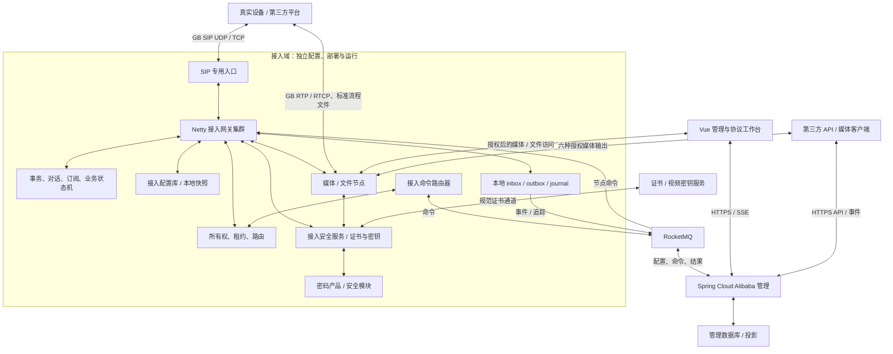
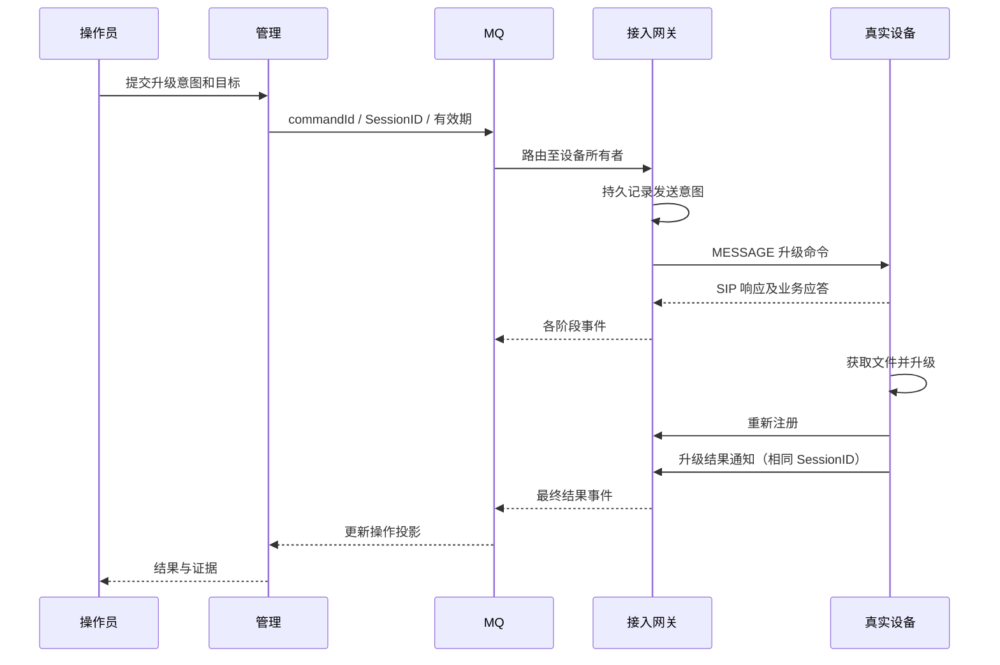
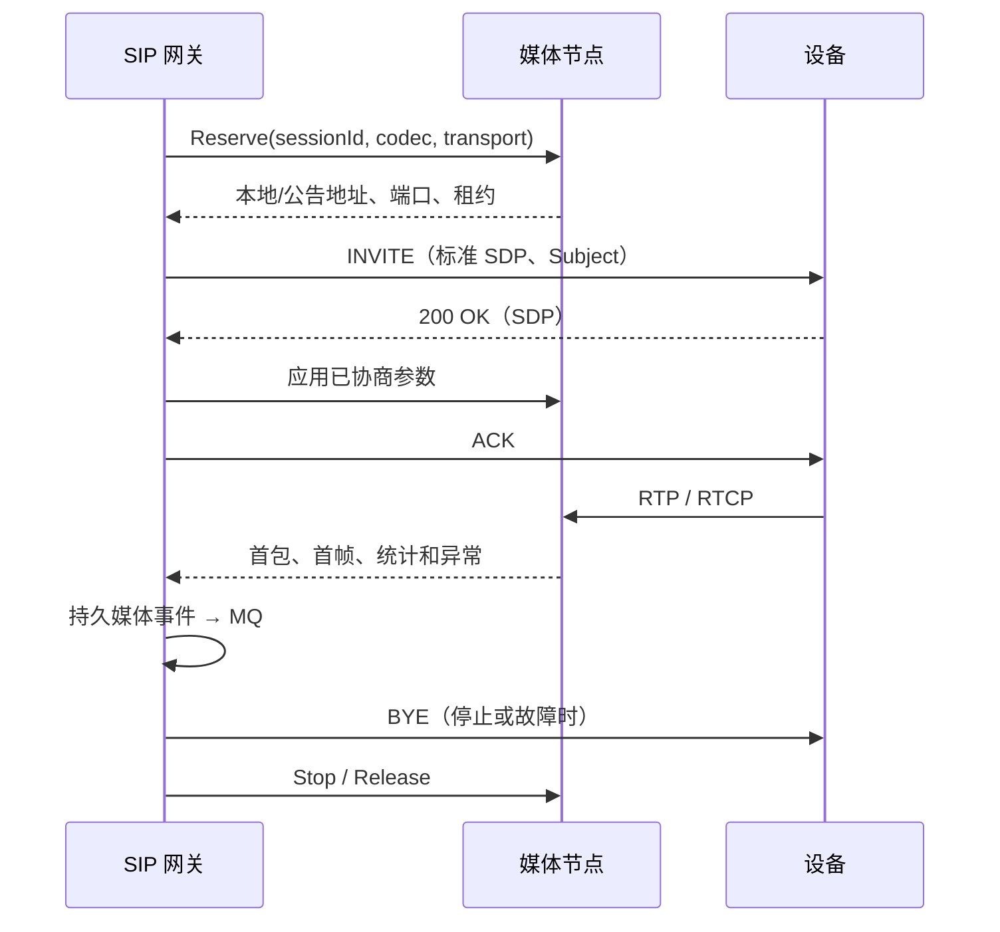

# GB28181 Hub 设计文档

| 项目 | 内容 |
| --- | --- |
| 项目 / 工程 | GB28181 Hub / `gb28181-hub` |
| 中文名称 | 国标视频接入与管理平台 |
| 文档维护 | 随 main 持续更新；原始设计基线 2026-09-15，组织方式更新 2026-10-07 |
| 需求基线 | [GB28181 Hub 需求文档](requirements.md) |
| 设计状态 | 可分解开发的架构与契约基线；参数须经原型和容量门禁验证 |

本设计独立维护 GB/T 28181-2022 与 GB 35114-2017 的平台、接入、安全、管理、媒体及工作台完整实现边界。所有标准映射、Schema、测试向量及发布资料均归本仓库管理。[GB28181 PDF](https://github.com/chialecaleb/gb28181-workspace/blob/main/docs/standards/GBT28181-2022/GBT28181-2022.pdf)、[GB35114 PDF](https://github.com/chialecaleb/gb28181-workspace/blob/main/docs/standards/GB35114-2017/GB35114-2017.pdf) 为条款核对入口；文中未另注明的容量、超时与队列上限均为产品初始策略，不是标准原文。需求中的功能去重结果见需求第 1.3 节，新增 HUB-S / HUB-P 的设计与验收映射见本设计第 15 节。

## 1. 技术决策

| 决策 | 选定方案 | 理由与约束 |
| --- | --- | --- |
| HUB-D-01 | Java 21 LTS；Netty 作为传输层 | SIP 协议内核为独立 Java 库，不依赖 Spring 容器或管理服务 |
| HUB-D-02 | `javax.sip:jain-sip-api:1.2.1.4` + 自研实现 | 只依赖公共 API 制品，禁止 RI 及其派生实现；公开方法清单、字节码摘要在 M0 锁定 |
| HUB-D-03 | Spring Boot 3.5.x + Spring Cloud 2025.0.x + Spring Cloud Alibaba 2025.0.x | 采用完整 BOM，M0 锁定具体补丁、JDK、Netty 及 MQ 客户端组合 |
| HUB-D-04 | RocketMQ 5.x 为命令与事件总线 | 以应用幂等和持久日志建立可靠语义，不假定消息总线提供远端动作恰好一次 |
| HUB-D-05 | Vue 3 + TypeScript + Vite；Pinia 管理页面状态 | 目录、操作、时序及媒体窗口分模块；API 客户端从本仓库 OpenAPI 生成 |
| HUB-D-06 | 管理库与接入配置库各自支持 SQLite3 / MySQL / PostgreSQL；集群使用 etcd 所有权存储 | 两域数据库 / 凭据独立；SQLite 单机单写，MySQL / PostgreSQL 承担多实例剖面；etcd 用于租约和 CAS |
| HUB-D-07 | 网关本地追加日志 + inbox / command journal | MQ 不可用时有界缓冲；崩溃恢复不依赖管理投影 |
| HUB-D-08 | 独立媒体节点；GB 封装 / 会话适配 + FFmpeg/libav 编解码适配 | 协议收发、转发和昂贵编解码分开；实际选用的编解码后端逐项验收 |
| HUB-D-09 | 必交付 WebRTC、RTSP、RTMP、HTTP-FLV、Websocket-FLV、HLS 输出 | WebRTC 为默认低延迟路径；编解码、封装、授权与安全派生分别判断，不能宣称所有编码适配所有客户端 |
| HUB-D-10 | Linux 单机与集群两种部署剖面 | 单机可同机部署独立进程，集群独立扩缩容；不以一体进程隐藏管理依赖 |
| HUB-D-11 | 独立 GB35114 规则层、安全服务及密码提供器 | A / B / C 全部实现；接入域拥有证书、密钥和安全状态，不同步依赖管理认证服务 |
| HUB-D-12 | 统一账号 / 资源策略，CAS 与 OAuth 2.0 / OIDC 身份适配 | SSO、国密证书用户认证和安全角色多因子分别建模；所有入口使用同一权限结果 |

Spring Cloud Alibaba 官方矩阵明确了 2025.0.x 对应 Boot 3.5.x / Cloud 2025.0.x，本设计选定该版本线而不混用 Boot 4.0.x。发布时按锁文件和安全验证确定补丁，不从本设计推断任意“最新版”均兼容。[官方版本说明](https://sca.aliyun.com/docs/2025.x/overview/version-explain/)

兼容制品的坐标可从 [Maven Central POM](https://repo.maven.apache.org/maven2/javax/sip/jain-sip-api/1.2.1.4/jain-sip-api-1.2.1.4.pom) 核对；公共工厂发现约定见 [SipFactory API 契约](https://docs.rhino.alianza.com/ocdoc/books/sip/3.1/jain-sip-api/javax/sip/SipFactory.html)。这些是接口依据，不授权引入其文档中提到的参考实现。

## 2. 系统边界与模块



SIP 入口为四层传输入口或 SIP 感知路由组件；普通 HTTP API Gateway 不用于 SIP 分流。媒体直达浏览器属于数据通道，媒体状态、文件索引和访问审计仍由接入域经 MQ 上报管理。运维探针可向基础设施监控输出健康与资源指标，不作为管理读取设备业务状态的旁路。

建议工程布局如下，均为待开发模块：

```text
gb28181-hub/
  hub-bom/                    依赖及插件版本
  hub-sip-kernel/             SIP 字节、传输、事务、对话、路由、时钟
  hub-jain-adapter/           javax.sip 公共接口的自有实现
  hub-gb2022/                 GB 模型、规则、编解码、能力及业务状态机
  hub-gb35114/                A/B/C 安全规则、认证、信令和媒体扩展
  hub-security/               证书、信任、密钥生命周期、安全审计
  hub-crypto-spi/             密码产品、软件研发提供器及安全介质适配
  hub-access/                 Netty 网关、接入应用与本地持久日志
  hub-access-control/         所有权、配置分发、节点命令路由
  hub-media/                  媒体会话、接收转发、文件及浏览器适配
  hub-recording/              录制计划、分段、索引、保留与导出
  hub-identity/               用户、角色、资源策略、SSO 与证书身份
  hub-storage/                三数据库方言、迁移、备份与恢复
  hub-management/             管理 API、命令 outbox、投影、权限
  hub-contracts/              仅本产品内部的 MQ / API / IPC 契约
  hub-web/                    Vue 前端
  protocol-assets/            已审核条款索引、字段规则、测试向量
  tests/                     API、协议、互操作、故障和容量测试
  deploy/                    单机、集群、监控和恢复模板
  docs/                      需求、设计、标准和决策记录
```

依赖方向为宿主 → 应用服务 → GB 业务 / SIP 内核；JAIN 适配层依赖 SIP 内核，不允许内核反向依赖管理。gb35114 组合 SIP、GB 业务和 crypto-spi，不引入第二套 SIP 栈。媒体组件执行已授权的资源预留、启动、关闭、观察及安全派生策略，不自行授予设备操作权。管理无权直接写接入运行状态表。

## 3. 接入与管理的数据所有权

| 数据 / 状态 | 权威所有者 | 管理可见形式 | 生命周期 |
| --- | --- | --- | --- |
| 设备允许接入、凭据、授权策略 | 接入配置库中的已应用版本 | 期望版本 + 应用事件投影 | 版本化、可离线导入 |
| 用户、角色、操作范围 | 管理；签发到接入的策略快照 | 管理实体 | 管理变更后经 MQ 生效 |
| 注册、连接、事务、对话 | 所属网关 | 事件及带采集时间的状态视图 | 连接 / 协议定时器驱动 |
| 所有者和代次 | 接入 etcd | 所有权事件摘要 | 租约、CAS 和节点隔离 |
| 订阅与业务会话 | 所属网关，必要元数据持久化 | 操作 / 订阅事件 | 过期、取消或终止 |
| 媒体端口、收发任务、文件 | 媒体节点 + 接入协调器 | MQ 索引、指标和状态 | 资源租约、会话和保留策略 |
| 用户操作 / 下行命令 | 管理 command/outbox + 接入 inbox | 多层结果 | 保留到审计期限 |
| 设备与通道目录 | 远端设备 / 平台是业务来源 | 管理版本化投影 | 查询快照和通知增量 |
| 原始报文与规则证据 | 接入采集，MQ 交付管理证据库 | 授权查询 | 容量与保留期限约束 |
| 证书信任 / 撤销、域安全配置 | 接入安全服务中的已应用策略；标准证书服务提供状态来源 | 版本、指纹、有效期、获取时间及应用事件 | 信任、CRL 有效期与角色策略 |
| 私钥、VKEK / VEK / VEMK | 接入安全模块及密钥目录 | 仅引用、版本、用途、生命周期与故障 | 注册 / GOP / 轮换与历史录像保留 |
| 平台录像计划及运行状态 | 管理发期望计划；接入持实际计划、媒体节点执行 | 配置及录制 / 文件事件 | 管理停机仍按有效计划录制 |
| 布局、轮巡、虚拟目录 | 管理中的用户配置 | 权限过滤后的配置及运行任务 | 不改变标准目录和原始 GB 身份 |

管理存储 `desiredConfigVersion`，接入上报 `appliedConfigVersion`。更新采用 `baseVersion → targetVersion + digest + changes`；基础版本不匹配时接入通过 MQ 请求完整快照。完整快照以有界块经 MQ 传输、校验和组装；不提供回查管理配置的 HTTP 后门。

首次安装由接入 CLI 导入本地签名 / 校验包，包含平台身份、证书链、凭据引用、接入 / 安全策略和媒体节点配置。单机默认接入专用 SQLite 库并生成校验快照；集群启用接入自己的 MySQL / PostgreSQL 和 etcd。安全模块可离线解封必要密钥，证书服务 / CRL 缓存有明确有效期。离线启动不能读取管理数据库作为长期依赖，也不能因管理缺席取消证书、密钥或授权校验。

## 4. 自研 SIP 内核与 JAIN 适配

### 4.1 分层与线程模型

```text
UDP Datagram / TCP Byte Stream
  → 边界检查、SIP 定帧、最小头域索引
  → 事务匹配 / 重复报文识别
  → 有界的设备 / 对话执行分片
  → GB 编解码、语义校验、业务状态机
  → 发送意图 / 媒体任务 / 持久事件
  → GB profile 序列化、鉴权、长度、实际写出
```

Netty EventLoop 只负责网络、轻量定帧和投递；XML 解析、密码计算、磁盘、MQ 和媒体调用交给有界执行器。每个 binding 的可变状态归单一 mailbox；对话及跨设备操作使用明确的协调消息，不用多把锁跨 EventLoop 等待。

统一分片定时器管理协议定时任务，区分 RFC 的事务重传计时、GB 注册 / 心跳计时与业务任务超时。计时使用单调时钟，日志另存 UTC。积压时不为每个设备创建线程，也不为每次心跳创建无上限异步任务。

ByteBuf 所有权只保留在网络层或显式引用计数范围。跨线程消息使用不可变字节片段 / 有界拷贝；终止路径必须释放引用。编码正文的原始字节、解码文本、解析树分开保存，追踪可按需保留，避免全量三份复制。

### 4.2 定帧与字节行为

- TCP 以头部结束标记和最终 `Content-Length` 取正文；支持任意切分、多个消息粘连和正文含换行。一个读事件不等于一条 SIP 消息。
- UDP 按一个数据报解析，验证报文边界与字节长度；输出过大消息按 RFC 3261 第 18 章和附录 M 选择 TCP，不自行把 SIP 字节流分成私有数据报。
- 支持长 / 短头域、合法大小写、重复可重复头、参数转义、URI 和 Route 集合；矛盾长度、非法控制字符和超限消息按经过审核的 SIP 错误策略处理。
- 初始限制为头 64 KiB、整消息 16 MiB，均可配置；大目录测试必须覆盖合法的 10000 条上限与实际字节数。资源上限导致拒绝应标为资源失败，不能标为标准语法错误。
- 禁止 XML 外部实体、DTD 外部解析和无界展开。深度、节点数、列表长度、解析时间有上限，原始输入保留摘要供诊断。

### 4.3 事务、对话和路由

事务键按 RFC 3261 构造，不能单用 Call-ID。实现 INVITE 客户端 / 服务端事务及非 INVITE 事务；处理传输可靠性差异、重复请求重发缓存响应、超时和终止事件。

2xx ACK 由对话逻辑处理，非 2xx ACK 与 INVITE 事务关联。CANCEL 本身有事务且不能替代 BYE；CANCEL 与最终 2xx 交叉时，成功建立的对话仍需 ACK 并按意图 BYE。事务重传不能触发第二次升级或录像控制。

对话以 Call-ID + 本地 / 远端 Tag 标识，维护 route set、remote target、local / remote CSeq、角色和 early / confirmed / terminated 状态。业务应答可能是新的 MESSAGE 事务，按域、目标、CmdType、SN、会话语义匹配，不强制其 Call-ID 与原请求相同。

出站路由依次考虑对话 route set、remote target、已验证注册绑定及传输策略。不能对每条消息信任未经鉴权的 Contact 改写设备路由。Via、rport 等基础 SIP 行为按适用 RFC 和测试向量实施；NAT 结果必须以实际第三方测试证明。

### 4.4 公共 API 兼容合同

| API 面 | 设计与验证 |
| --- | --- |
| SipFactory | 应用显式 `setPathName(vendorNamespace)`；实现类按 `${vendorNamespace}.javax.sip.*Impl` 及子包命名。发布使用项目实际控制的命名空间，未锁定前不得依赖默认发现路径 |
| SipStack / SipProvider / ListeningPoint | 生命周期、唯一性、多个监听点、UDP / TCP、关闭与监听器事件；通用 API 要求的其他传输按清单实现或按合法契约声明 |
| Message / Header / Address | 实现全部锁定 public 签名、解析 / 修改 / clone / equals、参数和迭代行为；只返回自有对象 |
| ClientTransaction / ServerTransaction | 状态机、请求 / 响应、重传及超时回调，与实际网络行为一致 |
| Dialog | CSeq、route set、ACK、会话内请求、生命周期与合法异常 |
| SipListener | RequestEvent、ResponseEvent、TimeoutEvent、IOExceptionEvent、事务 / 对话终止回调；同资源事件有序，回调不阻塞 I/O |
| 缓冲和并发 | 提交发送后消息冻结为不可变 wire snapshot；应用后续修改不改变已发送字节。clone 不共享可变子对象 |

工厂发现测试只加载 API jar 和自有实现 jar，遍历实际制品 public 清单。CI 排除 RI、任何 RI 内部包和拷贝来源；不运行 RI 作比较实现。对外行为验证依靠 API 契约、RFC、人工审核字节向量和独立网络测试工具。

GB profile 处理 GB 18030、9.10 特殊 Date 和标准扩展。通用 API 的 RFC Date 语义不被全局改写：语义对象存明确时区的时间，通用序列化与 GB wire 序列化分别测试；原始入站字节独立保存。需要保留的未知标准扩展采用可扩展头域对象，不能把原始文本丢失后声称字节保真。

## 5. GB 能力、规则与知识资料

### 5.1 单条操作定义

```yaml
capabilityId: HUB.PTZ.MOVE
standard: GB/T 28181-2022
role: platform-controller
clauses: ["9.3.1", "9.3.2.1", "A.3.1", "A.3.2"]
source: {standard: "GBT28181-2022", asset: "GBT28181-2022/GBT28181-2022.pdf", printedPages: [23, 100, 101]}
match: {method: MESSAGE, contentType: Application/MANSCDP+xml,
        root: Control, cmdType: DeviceControl, child: PTZCmd}
businessResponse: none
observations: [sip_response, optional_precise_state, optional_media_effect]
reviewState: reviewed-source-pending-implementation
```

Schema 描述字段结构，语义规则描述必选条件、枚举、单位、设备角色和业务状态；状态处理器实现作用。各层共用 capabilityId，但不得把“字段能解析”当成“功能已实现”。条款原文、产品解释、模拟 / 测试策略和已验证证据分别展示。

PTZ 解码检查首字节、组合码、8 字节长度、低 8 位校验和、各方向互斥、速度及目标 ID；A.3 控制按子命令族分别解码。PTZ 方向按表 A.4 的显示图像移动方向验证。操作页面的长按形成启动，松开形成停止；可选自动停止由产品策略记录，不标为标准要求。

工作台的一个独立验收例是向通道发送如下业务正文。此处仅示范 XML；实际 SIP 头、鉴权、SN 和字节长度由准备阶段形成并展示。

```xml
<?xml version="1.0" encoding="GB18030"?>
<Control>
  <CmdType>DeviceControl</CmdType>
  <SN>1</SN>
  <DeviceID>34020000001310000001</DeviceID>
  <PTZCmd>A50F0002400000F6</PTZCmd>
</Control>
```

其中字节 4 的 `02` 为表 A.4 的左方向位，字节 5 的 `40` 为水平相对速度 64，末字节 `F6` 等于前七字节之和模 256。SIP 确认后 businessState 应为 not-applicable，工作台以精准状态 / 实际画面另行验证效果；停止采用相应标准停止指令。此用例不能依靠固定生成一条成功 XML 通过。

### 5.2 覆盖管理

GB28181 第 4—9 章、附录 A—O 形成条款树，A.2 每个控制 / 查询 / 通知 / 应答、A.3 每个指令族、A.4 每个类型单独有叶节点。GB35114 第 4—7 章及规范性附录 A—C 另建条款树，C.1—C.7 每个角色 / 方向 / 子流程均有叶节点；附录 D / E 标注资料性及产品选用决定。GB28181 附录 H 的资料性、附录 K 的目录 / 正文差异单列记录。未校对的 OCR 片段不能进入生产校验器。

规则键扩展为 `standardVersion + capabilityId + role + direction + securityProfile`；来源支持多个标准和原文定位。维护 GB35114 对 GB28181-2016 的引用与 2022 对应条款映射。每个差异记录来源、处理规则、测试向量和审核状态，不能把 2016 安全流程直接交给只识别 2022 的模板。安全等级、产品承诺、实现进度与验证证据分别统计。

多响应聚合键包含平台域、对端、目标、CmdType、SN、查询代次；事务级重复只去重同一事务的重传，列表去重另按条目身份处理，不能仅凭相同正文误删合法记录。聚合保存 `expectedTotal、receivedItems、receivedParts、startedAt、lastPartAt、completeness`，完整、空、部分、冲突、超时分别返回。

初始无响应超时 10 s、后续批次空闲超时 15 s、整体上限按记录规模配置；这些是产品策略。SN 复用必须等待相关窗口结束。对没有足够关联字段的迟到结果保留未匹配证据，不能分配给最新查询。

## 6. 接入状态机与业务结果

| 状态机 | 核心状态 / 事件 | 持久化与恢复 |
| --- | --- | --- |
| 注册 | unknown → challenged → registered → expired / offline；刷新、注销、冲突 | 凭据与策略持久；连接不能从数据库恢复；重启后按重新注册建立有效绑定 |
| 媒体 | requested → reserved → inviting → waiting-ack → streaming → closing → closed / failed | 保留会话元数据与资源租约；不能将重建连接视为同一未中断对话 |
| 订阅 | pending → active → refreshing → terminated / expired | 保存对话、过滤与到期信息；重启后评估是否可续期，失效则重新建立 |
| 配置 | accepted → sent → sip-confirmed → business-responded → readback-verified | 保留期望值、实际值、请求版本；未知结果不覆盖已知实际值 |
| 升级 | accepted → sent → device-accepted → waiting-reregister → waiting-result → succeeded / failed / unknown | 以 SessionID 和设备关联，最终结果按标准通知；断电恢复不得自动重新升级 |
| 抓拍 | configured → capturing/uploading → notified → verified / partial / failed | 文件清单与通知分别关联，收到通知不等于图片均已接收 |
| 回放 / 下载 | negotiated → playing / paused → seeking / speed-changed → ended / closed | 位置、速率、区间与媒体进度一致；MANSRTSP 响应与 SIP INFO 响应分别记录 |
| 安全认证 | untrusted → challenging → peer-verified → key-installed → authenticated / rejected | 设备 / 平台 / 用户终端分别驱动，双向两端验证完成才可放行业务 |
| 安全媒体 | awaiting-parameters → verifying / decrypting → verified / incomplete / failed | 保存帧区间、证书及密钥版本，未验证不能展示为完整性通过 |
| 密钥轮换 | prepared → distributed → activation-pending → active → retired → destroyed | 准备 / 确认 / GOP 激活分开；历史引用未清零不能销毁 |

业务操作记录多个维度：`dispatchState、sipState、businessState、effectState、terminalReason`。例如 PTZ 的 businessState 为 `not-applicable`，SIP 已确认而缺少画面证据时 effectState 为 `unknown`。页面可展示阶段汇总，但不能抹去这些事实。



设备文件获取和安装内部步骤不由 GB28181 完整规定。平台不得把自己的文件服务器内部调用协议强加给第三方设备。失败原因、最终固件与字段名均来自审核后的 A.2.5.9 模型。

## 7. MQ 契约与可靠性

### 7.1 通道与信封

| 通道 | 生产者 → 消费者 | 顺序 / 用途 |
| --- | --- | --- |
| `hub.command.ingress.v1` | 管理 outbox → 接入路由器 | 按 domainId + bindingKey 分区，保持设备命令必要顺序 |
| `hub.command.node.v1.{nodeId}` | 接入路由器 → 指定网关 | 每节点独立主题 / 订阅；其他节点不竞争该设备连接命令 |
| `hub.config.v1` | 管理 outbox → 接入配置服务 | 全量 / 增量配置分发，版本校验及 applied 事件 |
| `hub.event.v1` | 接入 journal → 管理投影 / 审计消费者 | 同 aggregateKey 按 epoch + sequence；各业务消费组可独立重放 |
| `hub.trace.v1` | 接入追踪 → 管理证据消费者 | 按 traceId / chunkIndex 分块，有界采样，不挤占可靠事件预算 |
| `hub.deadletter.v1` | 各失败投递 → 运维处理 | 保存失败原因、原 ID 与重放限制，不自动重复危险操作 |

```json
{
  "schemaVersion": "1.0",
  "messageId": "uuid",
  "kind": "command",
  "type": "device.ptz.move",
  "commandId": "uuid",
  "operationId": "uuid",
  "domainId": "3402000000",
  "deviceId": "34020000001320000001",
  "channelId": "34020000001310000001",
  "bindingKey": "internal-stable-key",
  "ownerNodeId": "access-03",
  "ownerEpoch": 27,
  "aggregateSequence": 810,
  "configVersion": 12,
  "createdAt": "2026-09-13T02:00:00Z",
  "expiresAt": "2026-09-13T02:00:02Z",
  "actor": {"subjectId": "operator-7", "policyVersion": 9},
  "protocolCorrelation": {"callId": null, "cseq": null, "sn": null, "sessionId": null},
  "payload": {"direction": "left", "panSpeed": 64}
}
```

这只是内部信封示意，字段名和 ID 不写入 GB 私有头域。签名 / 鉴权主体用于接入验证命令来源及策略版本。大原始报文通过带总长度、分块编号和摘要的追踪事件发送；不要求 management 读取接入文件路径。

涉及安全的命令增加 `securityProfileId、trustDomainId、policyVersion、credentialRef、requiredAuthContext`；仅传证书指纹、密钥引用 / 版本及安全模块可导入的加密包，不传私钥或 VKEK / VEK 明文。安全策略、CRL 更新、权限撤销、录像计划仍经配置 / 命令主题交付；事件分别报告应用成功与业务失败，不能把 MQ 投递成功当安全策略生效。

### 7.2 投递与执行步骤

1. 管理在同一数据库事务写 operation、command 和 outbox；提交后返回 202。发布失败可重试相同 messageId。
2. 接入路由器解析当前所有者，将原 commandId 路由到节点通道；其消费确认在节点通道发布得到确认之后。崩溃产生重复，由 inbox 去重。
3. 网关校验有效期、权限快照、目标绑定、配置版本、ownerEpoch 和 aggregateSequence；错误所有者返回可重路由结果，不转成未经追踪的节点间 RPC。
4. 网关先持久保存 `accepted / send-intent` 再发 SIP。已经处理的 commandId 返回已存状态；需要重新路由仍用原 commandId。
5. SIP 响应、业务应答和媒体观察产生独立事件。可靠事件落本地日志后再进入发送器；MQ 确认后推进日志发送游标。
6. 管理以 eventId 去重，在同一数据库事务更新投影和消费位置；旧 epoch / sequence 的事件保留审计但不覆盖新状态。

管理使用数据库设备序列器分配命令顺序，跨管理实例可串行。网关 mailbox 同时处理来自 MQ 的管理意图和来自上级平台的直接标准 SIP 意图，按到达顺序和资源状态决策；不声称两个不同来源具有全局原子顺序。

### 7.3 崩溃窗口与副作用

| 崩溃位置 | 恢复策略 |
| --- | --- |
| 管理事务提交前 | 无已接受命令；调用者可用同一幂等键重试 |
| outbox 已提交、MQ 结果不明 | 重发相同 ID；接入去重 |
| 接入 accepted 后、send-intent 前 | 未发生发送，可在未过期且仍持有所有权时继续 |
| send-intent 后、发送结果落盘前 | 可能已对外执行，标记 uncertain；查询 / 无副作用操作按规则恢复，重启 / 升级 / 格式化不自动重发 |
| 收到可靠通知、落盘前 | 不发表示可靠接受的成功响应；允许对端按协议重试 |
| 事件落盘后、SIP 响应前 | 对端重传通过事务 / 业务关联去重后获得响应 |
| MQ 确认后、本地游标前 | 可能重复事件，管理 eventId 去重 |

REGISTER、关键报警、业务结果等可靠接收，采用本地 durable append 完成后发出相应接受响应；磁盘 I/O 在专用执行器，协议超时与吞吐一起测试。心跳允许合并状态事件，但应记录观测时间、计数和序列；不能把每次心跳都宣称独立可靠审计。

本地日志使用分段追加、CRC、fsync / group commit、发送游标和恢复扫描。初始按节点预留 20 GiB（可靠日志与原始追踪独立配额）；70% 告警、85% 关闭全量追踪并限制新任务、95% 进入可靠日志保护模式。指标按 `实测每秒字节 × 故障窗口 × 余量` 调整，阈值为产品策略。

满载时继续优先处理存量媒体清理与必要协议释放，拒绝不能可靠接受的新业务；不得默默丢弃升级结果、关键报警或伪称无限离线无损。MQ 长时故障超过预算的 RPO 需要在运行报告中显式记录。

本地日志保证以磁盘完好为前提的进程恢复。节点磁盘永久丢失可能造成尚未投递事件丢失；要求该故障下零 RPO 的部署必须增加接入域的同步日志副本，并在可靠接受响应前完成所需副本确认。管理投影或设备状态快照能恢复当前状态，不能凭空恢复已经丢失的历史报警。

## 8. 横向扩展、所有权与故障隔离

### 8.1 所有权模型

`Ownership(domainId, bindingKey) = {nodeId, epoch, leaseId, endpoint, configVersion}`。创建 / 迁移通过一致性存储 CAS；epoch 单调增加。网关在有效租约内接收新业务，发送前检查本地租约与代次；失租后停止新增发送与接管。

仅有数据库字段和租约无法让远端设备识别内部 epoch。网络分区或进程暂停时，旧节点仍可能持有 TCP socket，因此强制故障切换还必须得到入口 / 出口隔离或旧进程终止的证据。没有隔离能力时，不开放存在双发风险的新所有者业务，状态显示等待隔离；不能把 lease 自检宣称为对网络的原子 fencing。

集群发布剖面需要入口连接撤销、节点网络封禁或宿主 fencing 的一种可测试机制。隔离旧节点后再允许新节点承接注册及发起控制。该取舍牺牲故障窗口内可用性以避免双主，不等于管理依赖。

### 8.2 入站与命令路由

- TCP 连接属于具体网关。现存连接不靠 MQ 消费组迁移；扩容优先接纳新连接，缩容排空旧连接。
- UDP 入口至少按流分布，覆盖同一源 IP 不同端口。单 socket 承载大量身份时采用有界 SIP 感知路由，不能只按源 IP 散列。
- 事务响应、对话内请求必须回到其所有者；目录 / 注册迁移不立即改变已有对话路由。入站转发若发生，仅在接入域内部并带所有权上下文，不修改为私有 GB 信令。
- 注册重定向按 9.1.2.3 实现，并对第三方单独验收。不能假设所有存量设备都支持重定向来保证基本集群可用性。
- 命令路由器消费后查询 owner，投递指定节点；拓扑缓存过期时以 CAS 版本和网关拒绝结果纠正，重路由次数 / 命令 TTL 有上限。

### 8.3 排空与恢复

节点状态为 `joining → serving → draining → fenced → stopped`。排空时先停止新注册分配和新媒体预约，处理现存会话到自然结束或窗口上限，再按协议终止并让设备重新注册。滚动升级不得同时排空同一所有权分区的全部可用节点。

网关故障后分别恢复配置、绑定、媒体和事件。TCP 连接与在途事务通常丢失，必须等待合规重注册和重新点播。初始测试目标：隔离完成后接入节点 30 s 内可服务；设备恢复计时必须包含其不少于正常 60 s 的注册重试策略，不能要求所有设备 30 s 内重新在线。媒体恢复按重新邀请测量；不宣称无损迁移。

| 依赖故障 | 接入行为 |
| --- | --- |
| 管理 / 管理库 / 管理缓存 | 接入持续；管理新任务不可用 |
| MQ | 既有协议工作，本地日志有界缓冲；接收不到新管理任务 |
| 接入配置库 | 有效快照内的设备继续；配置变更和未知设备不可接纳 |
| etcd / 所有权协调 | 在有效租约内运行，失租后限制发送 / 新接管，等待隔离恢复 |
| 媒体节点 | 仅相关媒体失败；SIP 心跳与其他节点业务持续，按协议终止失效会话 |
| 本地日志磁盘 | 进入保护策略，不能继续确认无法可靠记录的新业务 |
| 证书 / 视频密钥服务 | 在已验证信任及缓存有效期内按策略运行；过期或未知密钥不建立新受保护会话，历史缓存命中与未知分开 |
| 密码产品 / 安全模块 | 隔离受影响认证、签名或解密任务，触发安全告警；不自动回落软件或明文，其他不依赖该模块的绑定可继续 |

## 9. 媒体与文件子系统

### 9.1 媒体预约和会话闭环

接入网关与媒体节点通过本产品内部带鉴权的 RPC 交换 `Reserve、Start、Observe、Stop、Release`，携带 sessionId、ownerEpoch、codec、transport、地址及租约。该接口仅存在于接入域，不暴露给第三方设备。媒体节点拒绝失效所有者，并对同一 requestId 幂等。



端口按池预分配，未确认的预约有短租约；INVITE 失败、ACK 超时、BYE、媒体失联和网关失去所有权都有释放路径。媒体观察只送会话所属网关 / 接入协调器，再由可靠事件通道到管理。

UDP 接收、TCP active / passive 分开实现。TCP 使用两字节网络序长度标记后接 RTP / RTCP 数据，处理长度为零的合法空包以及跨读写边界；不能误用 RTSP 的 `$` 通道帧。[RFC 4571 第 2 节](https://www.rfc-editor.org/rfc/rfc4571.html#section-2)

验证协商的 payload type、SSRC、时钟频率和实际帧结构，按附录 C 检查 PS / PES / PSM、编码标识、SCR / PTS / DTS 与 RTP 时间戳。RTP 接收有界乱序窗口、序号回绕和统计，RTCP 作为单独标准能力；不把 RTCP 误当作所有丢包必然重传保证。

### 9.2 源复用、转发与浏览器

`MediaSourceKey` 包含域、标准媒体发送者 ID / 流序列号、业务类型、通道、码流号、回放区间 / 控制上下文及安全上下文引用。附录 L 的同源需求只发起一次上游请求，维护消费者引用；不同回放位置、信任域或不兼容安全上下文不能误合并。动态密钥版本由该上下文管理，不因每次轮换无限创建新源。

附录 K 中收到同一媒体源标识的新建链路请求时按规定清理旧链路，与本平台内部多个浏览器订阅复用已有源的行为分开测试。摄像头单源到 20 个窗口意味着 1 个上游媒体会话和 20 个输出会话，计费和统计分别计算。

浏览器适配优先从符合条件的 H.264 码流重封装到 WebRTC；编码 profile、音频或浏览器不兼容时申请转码资源。原始 GB 接收、解复用、安全处理、解码、输出编码分别标明能力，H.265 / SVAC 不能仅凭设备流已收到就标为网页可播。六种输出均须实现；HLS 允许较高延迟，不作为低延迟 PTZ 验收路径。

播放授权由管理发布权限快照和签名凭据，媒体节点离线验证，不能每包回查管理。已建立的会话依约定的有效期运行；管理停机不会使已有 GB 媒体立即中断。权限撤销按 MQ 应用版本生效，最大传播窗口进入安全配置和测试。

### 9.3 回放、下载、语音、抓拍与升级文件

- 回放使用 INVITE 建立媒体，对话内 INFO 携带 MANSRTSP。分别追踪 SIP CSeq、MANSRTSP CSeq 和播放位置；支持附录 B 的基本倍速、拖动与倒放响应值。
- 倒放接收须理解按 GOP 逆序、组内正序的码流，不简单要求所有 PTS 始终递增。传输时钟、媒体解码时间和录像时间分别处理。
- 下载完成需要协议结束证据和文件实际落盘验证；收到 SIP 200、连接断开或单个媒体包都不足以判定完整。保留部分文件与失败原因，按策略清理。
- 平台录制采用与设备录像分离的索引，标明时间来源、是否转码、缺口与校时偏差，原始 GB 存储封装按 6.3 检查。
- 广播与对讲使用各自标准流程和方向协商，允许浏览器麦克风、上传音频或媒体服务作为音源；不会将两个单向成功自动算作有效对讲。
- 抓拍通过标准配置中的 UploadURL 提供可达文件位置，按标准字段与实际支持的通用传输方式接收。SessionID、文件 ID、数量与 `UploadSnapShotFinished` 合并校验；地址访问凭据与内部对象存储密钥隔离。
- 升级文件对目标设备提供可访问 URL 和正确元信息，设备内部安装方式不在平台协议假设中；文件接口实现必须先与目标标准流程和第三方客户端验证，不能以自有 multipart / JSON 约定当作 GB 强制格式。

接入文件节点通过 MQ 发布索引、摘要和完成状态，文件本体存在其独立存储中，管理只持业务索引和授权信息。

### 9.4 多协议输出与播放会话

输出统一使用 `PlaybackSession`：主体 / 权限版本、sourceId、variantId、协议、音轨、安全派生决定、资源租约、有效期和终止原因。申请由管理授权并经 MQ 启动接入操作，接入预约 / 建流后发布结果；客户端获取受限地址或票据后直连媒体节点。协议握手与续期再次校验票据，HTTP 连接成功不能代替有帧、有音轨及音视频同步。

| 输出 | 实现边界 | 首轮互通剖面 |
| --- | --- | --- |
| WebRTC | 独立 SDP、ICE / STUN / TURN、DTLS-SRTP、拥塞 / 重连与音轨 | H.264 视频 + Opus 音频；支持的原始音频可直通，否则转换，锁定浏览器矩阵 |
| RTSP | RTSP 会话和 RTP / RTCP，支持 UDP 及 RTSP TCP interleaved | H.264 / H.265 与客户端支持音频；不能与 GB RFC 4571 定帧共用模式 |
| RTMP | 输出会话、重连、时间戳及音轨封装 | H.264 + AAC；其他编码扩展须另验，不能默认所有 RTMP 客户端支持 H.265 |
| HTTP-FLV | FLV 实时封装、流式 HTTP、断开回收和背压 | H.264 + AAC，经支持的播放器实际播放 |
| Websocket-FLV | 同 FLV 内容，通过 WebSocket / WSS 传输，限制发送缓冲 | H.264 + AAC，验证重连与慢消费者隔离 |
| HLS | 播放清单、分片、时间线、过期回收和全部子资源授权 | H.264 + AAC 的首轮配置；分片长度及累计延迟明示 |

六种协议输出全部交付，不意味着每种协议都承诺原生播放所有输入编码。输出解析器根据 `codec/container/client/security-policy` 交集选择直通、重封装、转码或拒绝。WebRTC 经 ICE / TURN 处理媒体可达性，短期 TURN 凭据与受控中继配额独立管理；GB 公告地址与浏览器候选地址分别配置和测试。

播放票据至少绑定主体、目标源、协议、有效期和权限版本；每条 HLS 清单 / 分片、FLV 握手、文件 Range 请求均受保护。WebRTC 建立连接后的授权生命周期也有上限。撤权通过 MQ 快速终止，MQ 不可用时由票据 / 策略租约的硬截止限制旧授权，不能声称撤权消息未到仍能立即全局失效。既有 GB 协议会话按接入域有效策略继续，管理停机与用户播放票据到期分别记录。

### 9.5 转码、多窗与轮巡调度

`MediaVariant` 包含 sourceId、视频 / 音频编码、profile、宽高、fps、bitrate、GOP、处理链、安全派生策略与版本。相同规格在允许的安全边界内复用，原始录制、不同回放游标、不同解密授权不可误合并。先以像素 / 秒、编码器并发、CPU/GPU、显存、带宽预约，再启动处理；失败返回资源原因和可选规格，不自行降低已承诺参数。

布局实体保存 1 / 4 / 9 / 16 槽位、资源引用、实时 / 回放模式、音频焦点和显示偏好。`TourPlan / TourRun` 保存窗口组、固定设备选择快照、停留时间、顺序、离线策略、游标与截止时间。轮巡控制器持租约，先验证下一项授权及有限预热，再在关键帧可用时切换，释放旧观看引用；关闭页面、停止任务或租约到期必须清理。平台录像和其他客户端仍持独立源引用，不被轮巡释放。

智能码流只选择经能力清单确认的标准码流；全屏请求较高规格，小窗及网络不足请求较低规格，切换具有滞回和最短驻留时间。设备不支持标准选流时，在用户授权及预算内申请派生流或报告不可切换；不为改善小窗体验修改设备全局编码或安全等级。页面明确显示输入规格、实际输出、重封装 / 转码与失败原因。

### 9.6 平台录像与存储生命周期

`RecordingPlan` 包含通道、时区、时间表、手动 / 报警规则、预录预算、保留期限、存储池、安全要求和已应用版本。计划经 MQ 下发接入独立保存，由接入域调度，管理停机不停止有效计划。预录使用有界缓冲；C 级源保留密文，不为预录建立无权限明文缓存。

录制状态为 `scheduled → reserving → recording → sealing → available / partial / failed → deleting → deleted`。媒体先封存分段对象及校验清单，再发布索引事件；数据库和对象存储不假设跨系统原子提交。用稳定 segmentId、临时对象、封存标记及周期核对修复“对象已写 / 事件未发”和孤儿对象，文件缺失不可显示可回放。

索引记录来源类型、通道、时间区间、codec、原始 / 派生、密文状态、证书 / 密钥版本范围、验签区间 / 缺口、对象摘要和保留锁。平台录像、设备录像和下载缓存分别查询，可提供统一搜索但结果必须标来源。密钥轮换跨段保存映射，历史回放按范围取全部所需版本；最新 VKEK 不能代替历史 VKEK。

清理按授权、保留锁、活动读取、对象引用和密钥引用决定；安全密钥销毁晚于全部关联保留需求解除。删除、过期和损坏均有审计。磁盘低水位限制新录制，达到上限封存可用段并报告缺口 / 失败，不通过删除锁定录像或复用错误密钥维持成功状态。

### 9.7 对讲、级联与云台控制占用

浏览器经 HTTPS 获取麦克风许可，音频适配器按协商转换采样率 / 编码并处理缓冲；AEC 等能力以客户端实际支持为准。`TalkSession` 保存参与者、方向、输入 / 输出音轨、每跳 SIP / 媒体关联、占用租约和终止原因，使用真实双向音频测试音或采集信号验证。按住说话、失焦、断网、取消和超时各有释放路径，媒体中断不得仅保留“对讲中”按钮。

PTZ 控制租约绑定操作者及通道，按权限和优先级协调多个控制源；本域自动停止是产品保护策略，不能写成 GB 标准要求。会话关闭时发送仍有效的标准停止意图，过期 / 结果未知按命令规则处理，不能补执行旧运动命令。级联目录与共享范围经权限过滤，路由检测路径环路、编码冲突和跳数预算；每跳明确认证主体、信任域和安全终结位置。

## 10. 管理数据模型与 API

### 10.1 主要实体

| 实体 | 关键字段 / 约束 |
| --- | --- |
| `platform_domain` | domainId、platformId、上级配置、网络地址、授权策略版本 |
| `device_desired` | deviceId（字符串）、角色、接入域、凭据引用、desiredConfigVersion |
| `device_projection` | observedState、reason、appliedConfigVersion、ownerEpoch、sequence、observedAt、consumedAt |
| `channel_projection` | channelId、parentId、目录快照版本、元数据、在线来源；父子关系无环 |
| `operation / command / outbox` | 幂等键、目标、意图、有效期、权限、各阶段状态；同事务落库 |
| `command_inbox / send_journal` | 接入侧 commandId、发送意图、原字节摘要、结果；与管理表不共库 |
| `subscription_projection` | event 类型、对话标识、过滤、到期、续期与最后通知 |
| `media_projection` | sessionId、源标识、输入 / 输出会话、codec、状态、统计、采集时间 |
| `recording / file_asset` | 设备 / 平台来源、时间区间、SessionID、存储对象、大小、hash、完整性 |
| `trace / trace_chunk` | operationId、实际方向 / 端点、事务字段、原字节、摘要、脱敏策略 |
| `standard_clause / capability` | 条款、PDF 页 / 区域、原文、解释、核对状态、能力与测试映射 |
| `consumer_inbox / projection_cursor` | eventId 唯一、aggregateKey、epoch、sequence、重放位置 |
| `user / external_identity / auth_session` | 稳定 subjectId、issuer + externalSubject、凭据状态、证书引用、认证因子 / 有效期、撤销版本 |
| `role / permission / role_binding` | 主体、角色、动作、域 / 设备 / 通道范围、允许 / 拒绝、策略版本；安全三角色约束 |
| `virtual_directory / resource_link` | owner / scope、parentId、排序、真实资源引用；不得用虚拟节点 ID 发 GB 请求 |
| `layout / tour_plan / tour_run` | 槽位、设备选择快照、轮巡参数、运行游标、租约和停止原因 |
| `media_variant / playback_session` | 输出规格、安全派生决定、授权主体、协议、源引用、配额、到期与撤销 |
| `recording_plan / storage_pool / retention_lock` | 计划及 appliedVersion、存储池、容量、保留锁、分段与密钥依赖 |
| `certificate / trust_profile / security_binding` | 四类证书、指纹 / 链 / CRL、主体与模块 ID、算法、标准及等级、认证状态 |
| `key_version / key_reference / verification_evidence` | 用途 / 提供器句柄、激活 / 退役、录像依赖、帧区间、验签结果；无明文密钥列 |
| `webhook_subscription / delivery / migration_job` | 订阅范围、签名密钥引用、eventId / 重试、迁移清单 / 校验 / 回退状态 |

跨域身份使用 `(domainId, deviceId)` 作为管理寻址键，但不能据此破坏标准要求的联网全局编码唯一性；检测冲突并阻止不明确路由。配置修改使用乐观版本，异步查询结果不得覆盖较新版本。

### 10.2 对外 HTTP API 与内部执行语义

此 API 同时服务前端及获授权的第三方集成，随发行提供版本化 OpenAPI、示例与变更说明。状态读取来自管理投影并附新鲜度，设备操作统一进入 MQ；第三方不获得网关或密码模块内部 RPC 权限。

| 接口 | 含义 | 返回与约束 |
| --- | --- | --- |
| `GET /api/v1/devices` | 查询分页设备及新鲜度 | 游标、过滤、总量摘要，禁止一次返回全量大型目录 |
| `PUT /api/v1/devices/{id}/desired-config` | 修改期望配置 | If-Match 版本，异步 applied 状态 |
| `POST /api/v1/operations` | 控制、查询、点播等意图 | Idempotency-Key，202 + operationId；本地无副作用校验失败返回明确错误 |
| `GET /api/v1/operations/{id}` | 查询完整执行维度 | 区分发送 / SIP / 业务 / 效果和未知 |
| `POST /api/v1/operations/{id}/cancel` | 取消未发送任务或请求停止会话 | 已发生的远端副作用不能回滚；取消结果异步 |
| `POST /api/v1/protocol/validate` | 纯本地确定性校验 | 无设备发送；远端状态基于当前投影并标新鲜度 |
| `POST /api/v1/protocol/prepare` | 经 MQ 请求网关准备实际报文 | 202，返回 preparedId 及后续准备事件 |
| `POST /api/v1/protocol/prepared/{id}/send` | 按准备的字节发送 | 匹配 hash、contextVersion、TTL；过期返回需重新准备 |
| `POST /api/v1/protocol/raw-send` | 授权原字节测试 | 明确目标、transport、预期操作和独立测试上下文 |
| `GET /api/v1/traces` | 分页信令证据 | 操作 / 设备 / 时间过滤，原文权限与脱敏 |
| `GET /api/v1/standards/{clauseId}` | 本地条款知识 | 原文定位、解释、核对 / 勘误及能力状态 |
| `GET /api/v1/events` | SSE 状态增量 | 游标 / 重连、过滤、限速和快照补偿 |
| `GET /api/v1/server-status` | 节点、版本、容量与业务健康 | 区分存活 / 就绪 / 接入 / 媒体 / 安全服务，受运维权限保护 |
| `/api/v1/users、/roles、/role-bindings` | 账号生命周期及资源授权 | 版本校验、三角色冲突检查、撤销会话和应用版本 |
| `/api/v1/auth、/sso-providers` | 本地 / CAS / OAuth 身份与证书认证 | 验证回调、主体绑定、认证因子、退出和撤销；不返回提供器秘密 |
| `/api/v1/virtual-directories、/layouts、/tours` | 目录编排、分屏及轮巡 | 权限过滤、版本、引用校验、运行任务 / 停止 |
| `POST /api/v1/playback-sessions` | 申请实时 / 回放及输出协议 / 规格 | 202 + operationId，建流后返回短期授权；关闭幂等 |
| `/api/v1/recording-plans、/recordings` | 录像计划、来源检索及生命周期 | 控制 / 删除为异步任务，保留锁、安全等级和密钥依赖必须检查 |
| `POST /api/v1/recordings/{id}/exports` | 授权下载或安全介质导出 | 明确导出模式、接收主体及证书 / 介质，阶段状态和证据可查 |
| `/api/v1/security/certificates、/key-operations` | 证书元数据与安全操作意图 | 仅元数据 / 加密包 / 引用，经过安全角色鉴权并经 MQ 应用 |
| `/api/v1/webhook-subscriptions` | 订阅状态、报警及任务事件 | 作用域、签名、eventId 幂等、有限重试、失败队列和重放 |
| `/api/v1/diagnostics、/backup-jobs` | 自检、诊断包、备份 / 恢复任务 | 配额、脱敏、进度和审计；恢复不直接覆写活动运行状态 |

这些 API 是 GB28181 Hub 自有管理接口，不是 GB28181 协议定义。错误结构含 `code、message、fieldPath、ruleId、clauseId、operationId、retryable`；内部错误码不得写成不存在的 SIP 或 XML 标准错误码。

准备阶段分配 SIP 关联字段和最终 GB 字节，返回原文及摘要供展示。发送前重新检查租约、会话、鉴权材料和 TTL，发生变化就使 preparedId 失效；不在用户点击发送后悄悄修改声称已经确认的原报文。后续由协议自动生成的挑战重试、ACK 等也作为实际独立报文进入时序。

第三方认证采用受限服务账号 / token，HTTP 方法和目标资源均参与授权；涉及国密用户操作还须满足证书认证上下文。错误包含稳定 code 与 correlationId，返回明确的 401 / 403 / 409 / 429 等 HTTP 语义；本地配置成功与异步设备执行成功分开。Webhook 在管理消费事件后投递，按 eventId 去重、指数退避与最大重试处理，不能阻塞设备信令；目的地址、签名密钥及重放权限受控。

### 10.3 账号、SSO 与权限关联

账号实体使用稳定内部 subjectId，用户可同时绑定本地凭据、CAS 主体、OIDC issuer + sub 及证书指纹；不能用可修改的显示名 / 邮箱自动合并高权限账号。账号禁用撤销会话和 API 凭据，并发布策略版本；删除保留审计主体标识，避免历史操作失去归属。

CAS 验证服务端票据、service 回调绑定与一次性使用，按配置处理单点注销。OIDC 使用授权码及 PKCE、state / nonce、issuer / audience / 签名 / 有效期校验；仅 OAuth 2.0 的供应方通过明确的身份端点及 token 校验适配，不接受客户端自行提交的用户身份。角色映射是受审核配置，不允许外部任意属性直接授予安全管理员。刷新、供应方不可达、证书换绑与账号停用分别有测试。

权限模型为主体 → 角色 → 动作 + 资源范围，资源可为域、设备、通道、录像、实验目标或审计记录。基础 RBAC 结合安全等级、是否加密、用户机构 / 类别 / 职级和认证强度属性；默认拒绝、显式拒绝优先。虚拟目录只是资源引用视图，继承规则不能绕过真实资源权限，移动节点不自动获得新权。

管理执行预授权，接入按已应用策略及真实绑定再判定，媒体按播放 / 导出票据执行；UI 隐藏按钮不作为权限边界。`AuthContext` 保存 subjectId、认证方式、证书引用、验证时间、有效期及策略版本，CAS / OAuth 登录不会自动增加 certificate-verified 标志。安全三角色的多因子、职责分离以及加密视频访问规则由同一策略引擎强制执行。

### 10.4 三数据库、迁移与一致备份

配置分别为 `management.storage.driver` 和 `access.config.storage.driver`，值为 `sqlite / mysql / postgresql`；两域即使同型也不能共享表、凭据或运行可用性依赖。Repository / UnitOfWork 定义事务、唯一约束、分页和版本锁契约，方言适配实现差异。业务关键条件不用 PostgreSQL 专有 JSONB / LISTEN 等能力承载；扩展 JSON 通过规范化字段与一致序列化保持跨库语义。

| 后端 | 运行约束 | 关键实现 |
| --- | --- | --- |
| SQLite3 | 单机、本地磁盘、每库单写者；禁止多个网关 / 管理实例共享网络文件 | WAL、busy 超时、有界写队列和 checkpoint；事务提交与 outbox 一致，备份使用一致快照 |
| MySQL | 支持相应域的多实例服务 | 事务表、行锁 / 乐观版本、明确字符集及大小写规则；不靠隐式类型转换 |
| PostgreSQL | 默认集群后端之一 | 事务、唯一约束、行锁 / 乐观版本；对外数据语义与其他后端一致 |

20 位 ID、密钥版本及含前导零字段均为字符串；时间保存 UTC 与必要时区，布尔、枚举、空值、JSON、精度和排序有跨库测试。不能把 PostgreSQL SQL 原样交给另两种数据库；每种后端独立版本迁移且拒绝未经验证的降级。

跨库采用维护窗口：停止新管理变更 / 相关计划写入并排空必要任务 → 一致快照和中立格式导出 → 新库导入 → 记录数、主外键、权限、索引、任务 / outbox 和摘要核对 → 切换配置 → 冒烟和恢复写入。接入库切换须先安全排空相关接入写入；仅管理库切换不关闭独立接入。迁移全程只保留一个权威写入端，六个有向迁移组合分别验证；失败回到原库快照并核对期间变更，不自动双写合并。

备份清单覆盖数据库版本、配置、对象 / 文件、证书、密钥版本引用和安全模块备份标识。私钥与视频密钥由安全模块按其能力导出加密备份，数据库备份不构成密钥备份。恢复先校验信任 / 撤销及历史密钥可用性，再重建投影和任务；不重放危险命令或复用旧所有权代次。

## 11. Vue 页面与证据展示

页面分为设备 / 虚拟目录、多屏与轮巡、录像 / 报警、级联拓扑、协议工作台、安全证书 / 密钥、集群运维和用户授权。工作台采用功能树、字段表单、报文编辑 / hex 视图、时序图、条款 / 校验面板和媒体证据区；侧边观察不阻塞发送。标准、A / B / C 等级及真实认证 / 验签 / 加密状态始终可见。

每个消息卡片显示 wire 时间、目标与源、字节长度、编码、Call-ID、CSeq、SN、SessionID（适用时）、方向、重传关系和校验结果。脱敏文本与原字节摘要分开，不能显示脱敏后的字节长度为实际发送长度。

结构化模式允许自动生成关联字段，原始模式保持字节完全一致。原始模式使用独立测试连接 / 事务空间；故意错误的 TCP Content-Length 不进入正常共享连接，避免污染其他会话。会话内负向测试先建立专门测试对话；响应无法关联时保留未知证据。

数据列表虚拟化，前端只订阅所选设备 / 操作；信令环形窗口默认最多 2000 条摘要，原始字节按需获取。SSE 按游标恢复；落后超过服务端保留窗口时重新拉快照并标记间隙，不能无提示丢失过程。4 窗观看为前端初始测试剖面，后端 100 路媒体独立验收。

布局支持 1 / 4 / 9 / 16 窗，16 窗的功能及资源要求另测；轮巡控制与每窗会话生命周期绑定。状态视图分别展示注册、心跳、通道、媒体、证书 / 密钥及采集 / 消费时间；TCP 断开、断流、心跳超时和投影陈旧不能合并成一个 online 布尔值。告警具备去抖、确认、恢复和通知去重，设备实际离线判定时间与事件到页面延迟分别统计。

## 12. 安全与资源控制

### 12.1 配置、实体与认证路径

`SecurityProfile` 保存标准 / 引用版本、实体角色、前端等级、允许算法、信任域、认证方向、信令规则、媒体签名 / 加密策略及失败策略。普通 GB28181 与 GB35114 规则分别测试，2022 第 8.6 条启用专项安全约束；TLS / IPSec、HTTPS 和 GB35114 码流保护不是同一开关。

接入安全服务实现设备 C.2、平台 C.3、用户终端 C.1 的认证协调以及 C.7 证书服务的客户端 / 所需域间服务适配。设备单向及双向都建模；正常 A / B / C 接入默认要求双向，平台间必须双向。Capability 协商只从双方已实现并被策略允许的算法中选择；不存在交集时失败，不能回落 Digest 或明文。

安全绑定包含 peerId、设备 / 密码模块 ID、证书指纹、角色、等级、协商算法、随机挑战、截止时间、认证代次与密钥版本。成功状态依次经过证书与身份绑定校验、挑战签名校验、密钥安全安装及双方确认；收到 200 OK 本身不是“安全已建立”。挑战仅一次接受，合法事务重传返回对应缓存结果而不重复产生密钥 / 副作用；跨事务重放拒绝。

B/S 证书认证按 C.1 引用流程实现，使用受控本地签名组件 / 密码介质提供挑战证明；不能假设所有浏览器的 WebCrypto 原生支持所需算法。组件验证调用来源、挑战、用途与有效期，不向页面导出私钥。C/S 用户终端采用标准 SIP 双向认证；两个路径产出统一 AuthContext，SSO 会话本身不充当此证据。

### 12.2 证书、密码提供器与密钥生命周期

`CryptoProvider` 提供能力查询、随机数、签名 / 验签、规定模式加解密、密钥生成 / 导入 / 封装 / 安全备份和销毁；使用不透明 keyHandle 与 purpose 约束。可适配经验证的密码产品接口及其 SDK，软件实现只用于明确标记的研发剖面。第 5.1 条的产品批准要求及 SM1 提供器、SM2 / SM3、SM4 模式、随机性分别出报告，不能用软件 SM4 通过覆盖全部算法。

证书服务维护用户、前端、服务器、平台四类证书及根 / 中间链、用途、有效期、CRL、主体与模块绑定，按 C.7 / GM/T 0014 对接查询 / 验证。申请与更新由证书服务和安全角色流程执行，信任变更带版本与审计。证书不可用、撤销、时间未知和可信状态分别表达；历史验签保存当时证书 / 信任证据及当前撤销状态，无法证明签名时刻可信时显示未知。

VKEK、VEK、域间 VEMK 与导出 VETK 按标准用途分开，禁止复用字段或密钥代替不同用途。C.3 的 cryptkey1 / cryptkey2 是相应安全封装结果，业务库保存引用而非明文。VKEK 注册更新且不超过 1 天，VEK 不超过 1 h；新 VEK 按 GOP 激活、同 GOP 不变、加密 GOP 的 IV 按 C.6.2 生成，安全参数须先于依赖它的编码数据发送。

密钥目录保存用途、产生 / 生效 / 退役时间、版本、提供器引用、分发确认及录像引用。轮换采用准备、分发、确认、GOP 激活、退役序列；失败保留明确状态，不把缺失版本替换为最新版本。跨域、源设备及各接收主体的封装密钥隔离，ClientVKEKNotify 关联会话 / 窗口 / SourceID 并按标准安全交付。

退役密钥不再用于新加密，但可在授权下解密关联历史录像；保存期限至少覆盖所有关联录像、保留锁与有效备份恢复需求。销毁前核对引用并审计。备份 / 恢复在安全模块支持的加密通道执行，新会话不得重用已消费挑战，新加密不得重用旧 VEK / IV 组合；历史密文可按授权原样回放。未知结果转人工核对或失败，不能生成同名新密钥冒充旧版本。

### 12.3 信令认证与跨域身份

入站先保留原始字节并完成有界定帧，再识别配置、验证认证 / Note、判权限，最后进入业务状态机。出站在业务字段、关联信息、字符集及 GB 头域定稿后，按审核规则计算摘要 / 签名并冻结字节；JAIN 的后续对象修改不能改变已签名报文。

GB35114 C.4 覆盖注册后的非 REGISTER 请求与响应。Date 的有效窗初值按 C.4 的 10 min 建模，结合可信时钟及策略配置；摘要覆盖字段、空正文、响应 METHOD 的来源、Base64 和字符编码使用独立向量冻结。公式与流程的具体字段取值、GB28181 Date 特例及字段分隔符必须保留审核记录，不泛化为随意的 HMAC-SM3 或 JSON 签名。认证失败丢弃 / 终止行为按已审核条款执行，产品错误只写内部事件。

本域发往外域的用户请求按 GB35114 第 6.7.3 条建立 Monitor-User-Identity，后续网关仅按规定追加本跳身份；安全配置采用该条的下划线分隔，普通 2022 配置按 GB28181 第 8.3 条采用连字符。两个配置分别解析和序列化，不能对原始已认证头域做全局字符替换。接收端同时验证已认证上游、允许路由和用户属性映射，不能信任外部任填的管理员身份。C.3 平台信任与用户资源授权分别判断；跨域重写标准允许字段后须按本跳安全上下文重新产生相应保护。

### 12.4 安全媒体与导出

GB35114 C.5 / C.6 的安全 NAL / RBSP 使用 GB/T 25724-2017 规定格式，不能把普通 H.264 / H.265 支持当作该格式已实现。适配器解析安全参数集、认证数据、绝对时间、帧关联、VEK 密文 / IV 及算法，按标准规定次序完成签名和加解密；具体受保护字节、树形杂凑及填充行为须由引用原文和独立向量锁定。

B / C 级签名视频必须使用 TCP；注册信令仍按适用 UDP / TCP 组合测试。发送 / 接收能力保持独立，禁止为兼容输出而要求对端改发未签名 UDP。SignatureControl / EncryptionControl 分别包含 SIP 响应、业务 Result 和实际媒体效果；停止安全功能可以在授权流程中实现，但活跃策略要求 B / C 保护的会话须拒绝或关闭，不继续标为安全成功。

接收路径为 `GB 网络接收 → 原始密文 / 签名数据保全 → 标准安全解析与所需解密 / 验签 → 安全结果 → 授权解码 / 转封装 / 派生`。加密原件直接存储，验签任务并行观察但不篡改原件；结果包含有效区间、缺失 / 损坏范围、签名身份及证书 / 密钥版本，局部通过不能汇总为全片通过。失败原件可按隔离取证策略保留，不能进入普通观看分发。

实时点播、历史回放、下载各自实现客户端主动和第三方控制流程、SDP 的 a=vkek、多历史版本与通知。回放拖动及倒放跨版本时重新选择所需密钥 / 安全参数，不能只在建流时取一次最新密钥。平台安全媒体服务器转发保留受保护数据；必须转码时创建派生资产并记录源证据，源签名不为新编码字节背书。

安全出口策略明确允许的接收主体、终结节点、解密 / 转码用途、输出协议和链路保护。C 级内容默认不向普通明文 RTSP / RTMP / HTTP / WS 放行；获准派生需满足证书用户授权和规定的安全通道 / 信任边界。HTTPS / WSS / DTLS-SRTP 的通道加密单独显示，浏览器兼容不能成为绕过国密授权的理由。

第 6.9.4 条导出与资料性附录 E 的产品选定流程落实到 `SecureExportJob`：校验用户 / 介质 / 权限 → 生成 VETK 与新 VEK → 受控解密并重新加密内容 → 写密文 → 将 VETK 和使用权限写入介质安全芯片 → 回读校验和审计。普通服务器下载接口不承担芯片能力；安全介质客户端与驱动须随支持矩阵交付。转换前后分别记录完整性及源证据，介质失败不交付标为成功的半成品，不宣称普通文件链接能够强制离线观看次数。

### 12.5 安全管理、审计与故障

安全管理员负责参数及服务管理，安全操作员执行授权密钥业务，安全审计员监督记录；角色互斥策略及证书加另一因子在 API 和应用层共同执行。用户、设备认证、密钥、验签、加解密、模块丢失 / 损坏等事件形成不可由普通业务角色修改的审计记录，含主体、目标、时间、结果、关联及证据摘要。前端安全日志获取按适用标准 / 引用接口建模，未知接口保持缺项，不能虚构 CmdType。

接入的证书、密钥服务及本地快照不依赖管理数据库；管理停机时有效信任、密钥、录像计划及既有标准会话继续。证书过期、CRL 超期、密钥 / 模块故障和授权到期仍按各自安全策略处理；独立运行不等于无限放行过期凭据。将故障影响限定到相关域、绑定及媒体，可靠审计按本地日志 → MQ 恢复，不经管理同步调用确认安全操作。

### 12.6 Web、内部通道与资源预算

HTTPS 覆盖前端、REST、SSO 回调、SSE、文件与 HTTP 媒体，WSS 覆盖 WebSocket；部署提供证书更新、到期告警、受信代理及安全 Cookie / CSRF / 来源校验。文件子资源和导出沿用资源授权，不因知道对象路径就可访问。

MQ 生产 / 消费方向、schema、大小、期限及权限版本校验不可省略；日志与追踪不输出私钥或解封后视频密钥。通用 URL 限制协议、目的地址、大小、超时和重定向，负向测试只允许授权目标和速率。资源预算增加密码操作、证书查询、验签队列、密钥缓存、转码、预录和分发扇出；安全验签过载明确拒绝 / 隔离，不能关闭校验或挤占心跳执行器。

## 13. 部署、运行与观测

| 部署单元 | 必要条件 | 独立性检查 |
| --- | --- | --- |
| SIP 接入 | 自有配置 / 凭据、SIP UDP/TCP 端口、日志磁盘、接入所有权组件 | 管理不可达时可冷启；Nacos 仅提供可缓存的发现 / 配置，不成为每次信令同步依赖 |
| 媒体节点 | 可公告地址、RTP/RTCP UDP 与媒体 TCP 端口池、文件存储、所需编解码运行库 | 无管理调用即可处理已授权会话与接入预约 |
| 命令路由 / 配置服务 | RocketMQ、接入配置库、etcd | 属于接入域，独立部署和权限 |
| 管理 | Spring Cloud Alibaba、独立选型管理库、MQ、可选管理缓存 | MySQL / PostgreSQL 剖面可水平扩展，SQLite 为单机；没有权威连接状态 |
| Vue Web | 静态资源、HTTPS 管理 API、可达媒体地址 | 静态资源自行发布，无其他产品站点依赖 |
| 接入安全服务 | 证书 / CRL、密码产品、独立密钥目录、C.7 证书服务配置 | 管理缺席可按有效策略运行；密码接口 / 驱动与批准信息入清单 |
| 安全用户 / 介质组件 | B/S 本地签名组件、C/S 终端及安全导出介质适配 | 私钥不上传页面；浏览器 / OS / 介质矩阵及真实验证随版本交付 |

默认示例端口：SIP 5060/UDP+TCP，管理 8443/TCP，媒体端口池 20000—39999；实际由部署配置锁定，并区分监听地址与对外公告地址。TCP 主动 / 被动及 NAT 必须有明确的可达性测试，不能只配置 SIP 端口。

单机演示允许同机运行各进程和基础设施；集群通过节点注册、容量声明、独立健康检查和排空扩缩容。发布包附数据库迁移、配置 schema、依赖清单、日志 / 磁盘预算和回滚步骤。协议规则版本与程序版本共同写入事件；不兼容 schema 采用新消息版本并行迁移。

单机快速启动默认两份独立 SQLite 文件；集群配置明确两域各自 MySQL / PostgreSQL 地址及凭据。外部存储、证书服务和密码产品是各自登记的基础设施依赖，不能指向另一产品的业务数据库或运行规则。自检覆盖 SIP / RTP、六协议出口、HTTPS、ICE / TURN、时钟 / CRL、密码提供器及存储；按普通 / A / B / C 发布可运行清单，缺少受保护能力的演示包不能标为完整交付。

观测包含在线 UA / 通道 / 绑定、连接数、事务与定时器延迟、队列水位、JVM / 直接内存 / RSS、日志字节增长、MQ 积压年龄、所有权冲突、命令过期 / 未知、媒体首包 / 首帧 / 丢包 / 帧率、解码 / 转码资源及文件完整性。基础设施指标供运维使用，管理业务视图仍来自 MQ。

## 14. 验证计划与性能方法

### 14.1 必做验证层

| 层 | 测试内容 | 合格证据 |
| --- | --- | --- |
| 字节与规则 | GB 18030 中文 / 边界字符、Content-Length、PTZ 位和校验、XML / SDP / MANSRTSP、原字节保真 | 人工审核输入输出向量，错误层次和条款可追溯 |
| SIP / JAIN | 分段 / 粘连、重传、重复、ACK/CANCEL 竞态、路由、对话、超时、工厂发现与 public API 清单 | 仅 API 制品编译客户端；网络行为和事件顺序符合契约 |
| 业务状态机 | 全 HUB-F 能力的成功 / 失败 / 取消 / 超时 / 资源清理 | 真实消息与状态、通知、媒体三方一致 |
| 媒体 | UDP/TCP 双角色、PS 与基本流、编解码、音频、倒放、快进、抓拍和下载 | 独立码流分析与实际解码，不能仅自有播放器通过 |
| MQ / 所有权 | 每个崩溃窗口、重复与乱序事件、过期 PTZ、配置缺块、磁盘保护、租约丢失和旧节点隔离 | 无双主发送、无危险动作盲目重试、未知结果可追踪 |
| 独立与互操作 | 全新部署、管理及数据库全停、真实设备、第三方上下级平台 | 无指定配套服务；版本 / 固件 / 标准能力和抓包入报告 |
| GB35114 | A / B / C 与全部实体、证书服务、单 / 双向认证、Note、签名 / 加密 / 轮换、跨域和安全导出 | 独立向量、真实密码产品 / 介质、完整性区间、两标准差异与全叶节点证据 |
| 平台产品 | 账号 / 角色 / SSO、REST / Webhook、六协议音视频、多窗轮巡、转码、录像 / 目录 / 对讲 | 越权 / 撤权及恢复、实际客户端、输入输出参数、停止清理和状态新鲜度 |
| 数据 / 恢复 | 三库功能、六方向迁移、配置 / 文件 / 历史密钥一致备份、回退 | 身份 / 精度 / 权限 / outbox 不变，恢复后不双写、不重放危险操作 |

### 14.2 性能剖面

先做单节点曲线，再做扩容比对。每次固定提交、BOM、硬件、源素材、网络、追踪采样和保留；预热 30 min 后采样，24 h 稳态后观察资源是否回到可解释的稳定区间。

1. 10,000 UA 的 UDP、独立端口模型和 10,000 独立 TCP 连接分开测；注册错峰、瞬时掉线、按标准重试分别测。
2. 100 路仅接收、100 路接收 + 单份转发、多观看端扇出、转码和录制分开测；媒体有效载荷 400 Mbit/s 不能替代总网卡预算。
3. 在 10,000 在线背景下混合查询、订阅、PTZ、回放和媒体结束，统计各阶段 p95 / p99 与失败原因。
4. 停管理 60 min、停 MQ 30 min、杀所有者、网络分区、媒体故障和磁盘水位分别演练；恢复数据包含 RTO、RPO、补发速度及陈旧投影窗口。
5. 按 GB/T 28181-2022 第 5.3 条的标准上限单测端到端延迟，报告同步时钟和测量误差，不用平均值 / p95 隐藏超限。

硬件不足时返回容量曲线和资源瓶颈；不得通过改变分辨率、关闭编解码、减少独立连接或忽略转发链路后沿用原剖面的达标标签。

### 14.3 国密与产品专项验收

普通、A、B、C 的容量和混合负载分别生成 manifest，增加密码产品 / 驱动 / 批准信息、算法模式、独立证书 / 密钥域、签名频率、轮换周期、CRL 状态、安全服务拓扑及派生输出数量。B / C 测试包含 TCP 媒体、密钥轮换峰值、跨版本回放 / 下载、平台双向级联、故障和恢复；不能通过让多台设备共享签名身份或关闭验签降低成本。

GB35114 第 7 章的 100 ms 双向认证、至少 1 次/s 签名及不超过 400 ms 加 / 解密新增延迟按原文边界逐项验证，记录网络条件、计时点、原始样本及排除项。它们是标准约束，不能用普通 HUB-N 的 p95 或纯算法微基准替代。签名频率既验证源端，也验证平台能接收、持久化及检查对应结果。

安全故障集包括撤销 / 过期证书、错误主体或模块 ID、算法无交集、挑战重放、Note / Date 错误、合法 SIP 重传、篡改 / 缺失认证数据、丢失历史密钥、轮换中断、模块 / 证书服务失效及越权导出；检查不能出现业务副作用或静默降级。安全日志、原始媒体、派生内容和 UI 汇总必须一致。

产品集对六种输出逐一验证音视频、授权 / 撤权、重连与慢消费者；对 1 / 4 / 9 / 16 窗和轮巡验证准入、预热及释放，对平台录像验证计划 / 预录 / 保留 / 磁盘满及管理停机，对三数据库验证同一业务合同和全部迁移方向。M5 的独立对端组合整体覆盖普通与 A / B / C 设备、上下级 / 同级平台、安全终端和介质；单个对端不支持的能力须由其他独立证据补齐。

## 15. 需求到设计的追踪

| 需求组 | 设计位置 | 验收集 |
| --- | --- | --- |
| HUB-R-001、HUB-J-001—006 | 第 1、4 节，sip-kernel / jain-adapter | HUB-T-02 |
| HUB-R-002—007、HUB-A-001—007 | 第 2、3、7、8、12、13 节 | HUB-T-03、04、07、08 |
| HUB-C-001—012 | 第 4、5、6、9、12 节 | HUB-T-01、02、05 |
| HUB-F-001、007—009、012—013 | 第 4—6 节，注册、查询、订阅状态机 | HUB-T-01、04 |
| HUB-F-002、010—011、014、020 | 第 6、9 节，媒体 / 播放 / 音频 | HUB-T-05 |
| HUB-F-003—005、015—017 | 第 5、6、9、11 节 | HUB-T-01、05、06 |
| HUB-F-006、018—019 | 第 5、6、8 节，事件、平台和扩展类型 | HUB-T-01、04 |
| HUB-U-001—008、HUB-R-008 | 第 5、10、11、12 节 | HUB-T-06 |
| HUB-R-009、HUB-S-001—018 | 第 2—6、9、10、12—14 节 | HUB-T-01、08 |
| HUB-P-001—004、009、014 | 第 9.7、10、11、12 节 | HUB-T-09 |
| HUB-P-005—008、010—012 | 第 9、11、12.4、12.6 节 | HUB-T-05、09 |
| HUB-P-013、016 | 第 3、9.6、10.4、12.2、13 节 | HUB-T-03、10 |
| HUB-P-015、HUB-N-001—012 | 第 7—9、12—14 节 | HUB-T-07、08、09、10 |

M0 冻结双标准角色 / 字段 / 差异和 JAIN 清单；M1 验证 SIP、认证、B / C 安全媒体原型及日志窗口；M2 完成独立设备 / 平台 / 用户闭环并锁定提供器与恢复合同；M3 补齐全部 HUB-F / S / P 和公共 API；M4 完成四类安全容量、迁移 / 恢复与故障；M5 发布双标准独立验收结果。HUB-G-01—06 的关闭记录留在本仓库，缺少任何必交付安全或产品能力时只可发布明确的阶段版本。


## 开发基线维护说明

技术栈、版本线及链接沿用原设计输入，本次文档组织不视为重新完成上游选型验证。实施前由 Agent 按[技术栈](tech-stack.md)核对实际存在的版本、维护状态、官方兼容矩阵与许可证，并用工程清单锁定选定依赖。工作区不锁定产品组合版本，不影响标准适用版本、依赖锁定、配置版本或测试证据记录。
